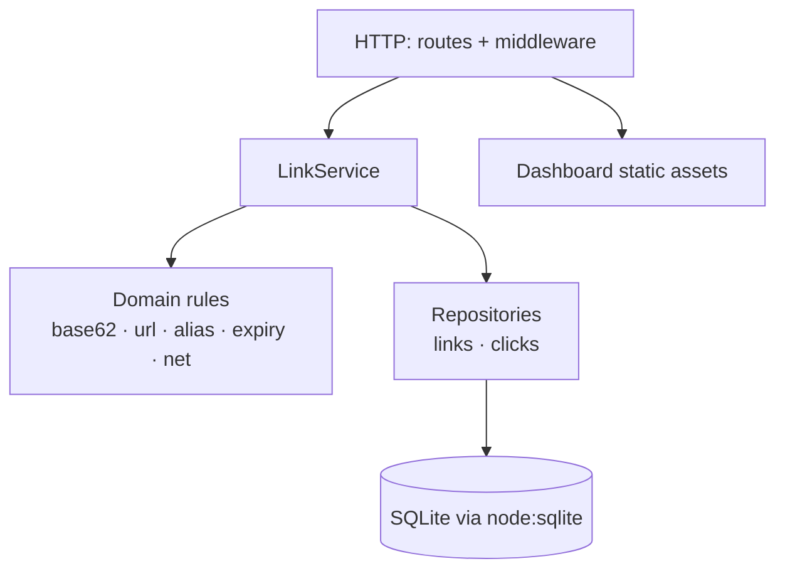
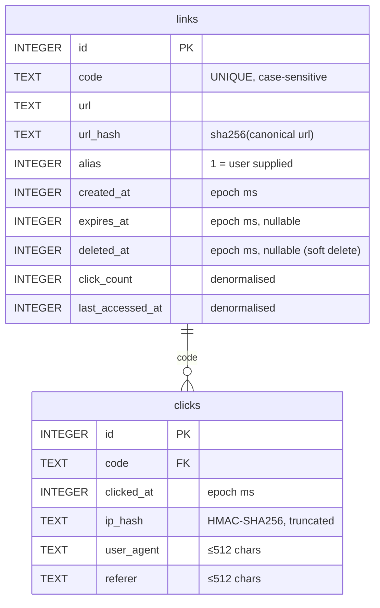
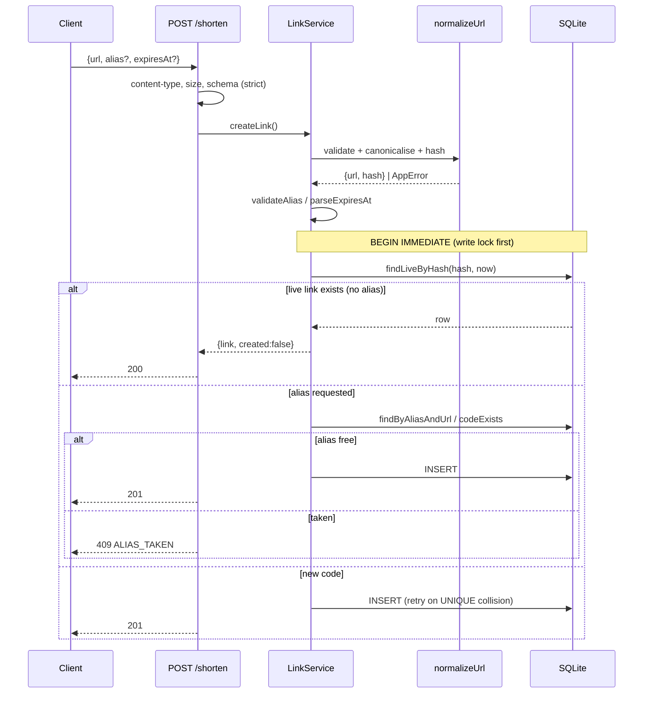

# Architecture

## Goals

1. Satisfy M1–M5 exactly and predictably.
2. Keep the redirect path fast and failure-tolerant.
3. Make every business rule testable without HTTP or a real clock.
4. Be honest about the single-node design and what scaling would require.

## Layers



Dependencies point **inwards**: `domain/` imports nothing from `db/`, `services/` or
`routes/`. That is what allows the URL matrix, alias rules and expiry rules to be unit
tested in microseconds, and it keeps Express out of the business logic.

| Layer       | Files                                            | Responsibility                                                                                                            |
| ----------- | ------------------------------------------------ | ------------------------------------------------------------------------------------------------------------------------- |
| Domain      | `src/domain/*`                                   | Pure validation and normalisation. Throws `AppError` with stable codes. No I/O.                                           |
| Persistence | `src/db/*`                                       | Connection + pragmas, forward-only migrations, prepared statements. Uses Node's built-in `node:sqlite` (no native build). |
| Service     | `src/services/linkService.ts`                    | Orchestration and transactions: create/resolve/delete/stats/list.                                                         |
| HTTP        | `src/app.ts`, `src/routes/*`, `src/middleware/*` | Parsing, auth, limits, headers, status codes, error envelope.                                                             |
| Support     | `src/lib/*`, `src/config.ts`                     | Clock, logging, HMAC/IP hashing, enum-validated env config.                                                               |

## Data model



Indexes:

| Index                                                                                         | Purpose                                              |
| --------------------------------------------------------------------------------------------- | ---------------------------------------------------- |
| `idx_links_code` (UNIQUE)                                                                     | Redirect lookup + alias collision detection          |
| `idx_links_dedupe` (UNIQUE, partial: `alias=0 AND expires_at IS NULL AND deleted_at IS NULL`) | Hard guarantee of one live non-expiring link per URL |
| `idx_links_url_hash`                                                                          | Dedupe/activity lookups including expiring links     |
| `idx_links_created_at`                                                                        | Dashboard listing order                              |
| `idx_links_expires_at` (partial)                                                              | Prune job                                            |
| `idx_clicks_code_time`                                                                        | Per-day aggregation and recent-clicks                |
| `idx_clicks_time`                                                                             | Retention/reporting across codes                     |

### Why denormalise `click_count`?

The dashboard lists 50 links per page. Joining and aggregating `clicks` for each row is
O(clicks) per page; keeping a counter on `links` makes listing a single indexed read.
The counter is updated in the **same transaction** as the click insert, and the `clicks`
table stays authoritative for per-day stats, so a drift would be detectable
(`SELECT COUNT(*)` vs `click_count`).

### Time storage

All timestamps are **epoch milliseconds (UTC, integers)**. Integer comparisons are
index-friendly and immune to timezone/locale bugs; formatting to ISO happens at the
service boundary. Daily buckets use SQLite's
`strftime('%Y-%m-%d', clicked_at/1000, 'unixepoch')`, which is UTC by definition.

## Request flows

### Shorten (M1/M3/M4)



`BEGIN IMMEDIATE` takes SQLite's RESERVED lock before the SELECT, so the
read-then-insert sequence is serialised across processes. Without it, two concurrent
requests could both observe "no existing link" and insert duplicates.

### Redirect (M2/M5)

```mermaid
sequenceDiagram
    participant B as Browser
    participant R as GET /:code
    participant S as LinkService
    participant DB as SQLite

    B->>R: GET /Ab3dE9x
    R->>S: resolve(code)
    S->>DB: SELECT * FROM links WHERE code = ? (index)
    alt missing
        R-->>B: 404 LINK_NOT_FOUND
    else deleted or expires_at <= now
        R-->>B: 410 LINK_GONE
    else live
        S->>DB: BEGIN; INSERT click; UPDATE link counters; COMMIT
        Note over S: failures logged, never thrown (fail-open)
        R-->>B: 302 Location + Cache-Control: no-store
    end
```

The click write is **inside** a transaction so the `clicks` row and the denormalised
counter cannot diverge, but **outside** the success condition: if it fails, the redirect
still happens. Analytics is not allowed to take the service down.

### Resolve-and-count race

Two simultaneous hits each perform their own transaction. SQLite serialises them, so
both clicks are recorded and the counter reaches 2. The `busy_timeout = 5000` setting
makes contention wait rather than throw.

## Concurrency and consistency

| Risk                                        | Mitigation                                                                   |
| ------------------------------------------- | ---------------------------------------------------------------------------- |
| Two requests create a code for the same URL | `BEGIN IMMEDIATE` + partial unique index; verified by a 20-way parallel test |
| Two requests claim the same alias           | UNIQUE index on `code`; the loser maps the constraint error to `409`         |
| Generated code collides                     | Retry up to 8 times, then `503 CODE_GENERATION_FAILED`                       |
| Click write fails mid-redirect              | Caught, logged, redirect proceeds                                            |
| Reader starves writer                       | WAL mode: readers never block the writer                                     |
| Process killed                              | Graceful shutdown closes the DB so WAL checkpoints                           |

## Cache and header strategy

| Route            | Caching                                                            |
| ---------------- | ------------------------------------------------------------------ |
| `GET /:code`     | `no-store` — the hop must never be cached or expiry/deletion break |
| `GET /stats/*`   | `no-store` — analytics change with every click                     |
| `GET /health`    | `no-store`                                                         |
| Static dashboard | `maxAge: 0`, `etag: false` (tiny assets, always fresh in the demo) |

302 rather than 301 is a correctness decision: 301 is heuristically cacheable and would
keep redirecting after a link expired or was deleted.

## Security posture (summary — details in `SECURITY.md`)

- Only `http`/`https` targets; every other scheme is rejected before storage.
- Private/loopback/link-local/metadata hosts blocked by default (`ALLOW_PRIVATE_HOSTS`
  for demos); numeric/hex IPv4 obfuscation is defeated because WHATWG `URL` canonicalises
  it before classification.
- Credentials in URLs rejected; self-references rejected.
- CSP without `unsafe-inline`, `X-Content-Type-Options`, `X-Frame-Options`,
  `Referrer-Policy: no-referrer`.
- API keys compared in constant time; production refuses to start without them.
- Visitor IPs stored only as HMAC-SHA256; UA/referer truncated; logs exclude target URLs.
- Body size capped at 8 KB; strict schemas reject unknown fields.
- Rate limits on global/write/redirect buckets.

## Performance envelope

Measured locally with the default 7-character codes:

| Operation        | Work                                                                 |
| ---------------- | -------------------------------------------------------------------- |
| Redirect         | 1 indexed lookup + 1 transaction (2 writes) — sub-millisecond on SSD |
| Shorten (new)    | 1 hash lookup + 1 insert                                             |
| Shorten (repeat) | 1 hash lookup                                                        |
| Stats            | 1 lookup + 1 aggregate over `idx_clicks_code_time` + 1 min/max       |

Prepared statements are compiled once at construction, so per-request parse cost is zero.
`code` is a 7-char indexed text key (≈ 4 KB per 1000 codes including the index).

**Growth limits:** at 1M links/day with 10 clicks each, `clicks` grows by 10M rows/day.
The retention story for that scale is partition/archive by month, which is out of MVP
scope and called out rather than pretended.

## Scaling path (deliberately not implemented)

1. **Rate limiting** — replace the in-memory store with Redis so limits are shared.
2. **Database** — swap SQLite for Postgres; the repository layer is the only code that
   changes (all SQL lives there). The `BEGIN IMMEDIATE` create-transaction becomes a unique
   index + retry loop.
3. **Cache** — put resolved codes in Redis (they are immutable apart from expiry), with
   the TTL capped at the link's remaining lifetime. Deletes must evict.
4. **Read replicas** — redirects are read-heavy; stats reads can be served from a replica.
5. **Click ingest** — buffer clicks in a queue (Kafka/SQS) and batch-insert, keeping the
   redirect path at one read.

## Deliberate trade-offs

| Trade-off                          | Chosen                  | Why                                                                                          |
| ---------------------------------- | ----------------------- | -------------------------------------------------------------------------------------------- |
| Redirect speed vs. exact analytics | Record synchronously    | Single-node SQLite write is cheap; a queue adds an operational dependency to the MVP         |
| Scope creep vs. focus              | No accounts, QR, dedupe | Brief asks for codes, redirects, validation, idempotency, stats                              |
| Soft delete vs. hard delete        | Soft                    | Preserves stats and prevents code reuse for a different destination                          |
| Alias vs. generated namespace      | Shared, case-sensitive  | One `code` column keeps lookup a single indexed read                                         |
| Code length                        | 7 (configurable 6–8)    | 62⁷ ≈ 3.5T combinations; brief allows 6–8                                                    |
| Native driver vs. built-in SQLite  | `node:sqlite`           | `npm install` needs no Python/C++ toolchain, so the project actually runs on a fresh machine |

## Choosing `node:sqlite` over a native driver

`better-sqlite3` is excellent, but it is a native addon: when no prebuilt binary matches the
platform and ABI it compiles from source, which needs Python and a C++ toolchain and fails
outright on many machines. Node 22.5+ ships `node:sqlite` with the same synchronous
ergonomics (`prepare`, `get`, `all`, `run`), so:

- `npm install` is pure JavaScript — no compiler, no Python, no rebuild on Node upgrades.
- The service layer keeps its synchronous, transaction-based design unchanged.
- Cost: transactions are managed with explicit `BEGIN`/`COMMIT`/`ROLLBACK` (wrapped in
  `transaction()` in `src/db/connection.ts`) instead of a `db.transaction()` helper, and the
  engine version tracks the Node release rather than npm.
